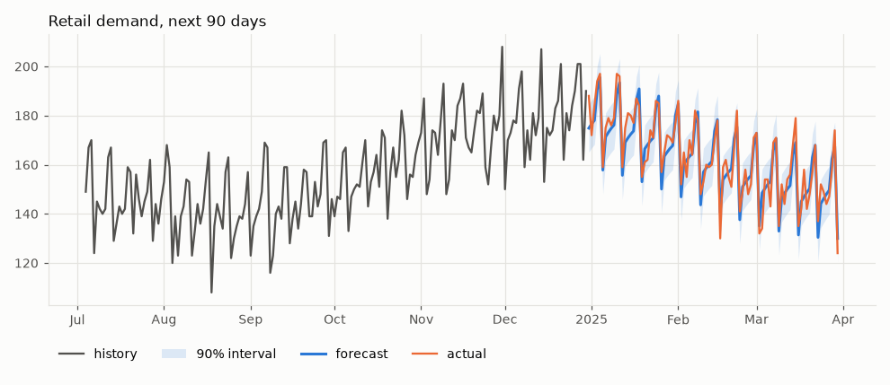
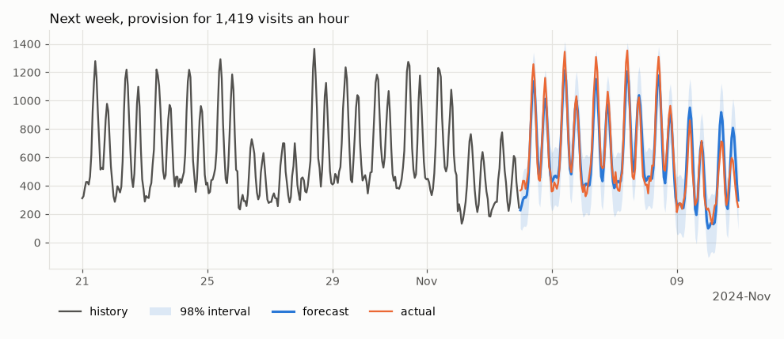
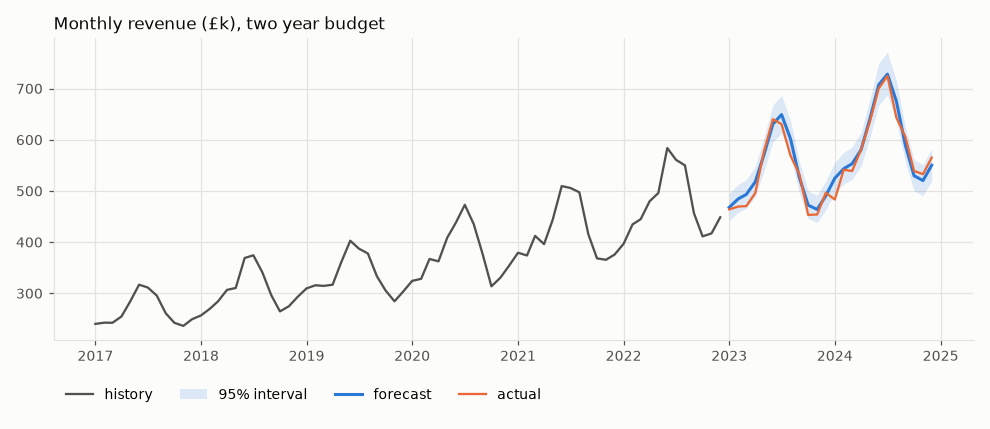
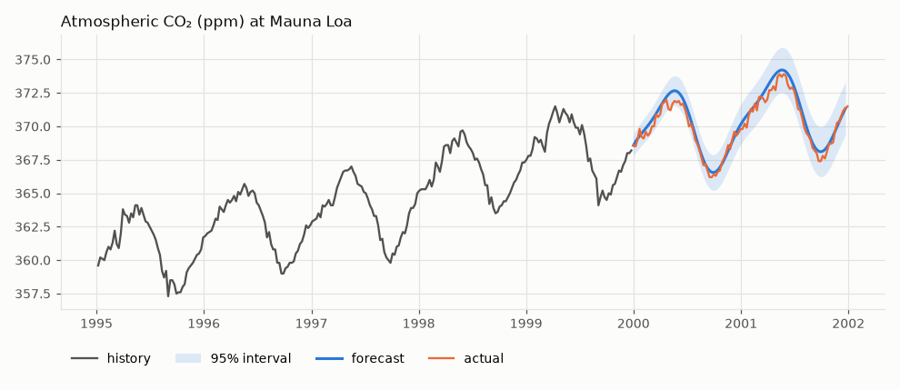
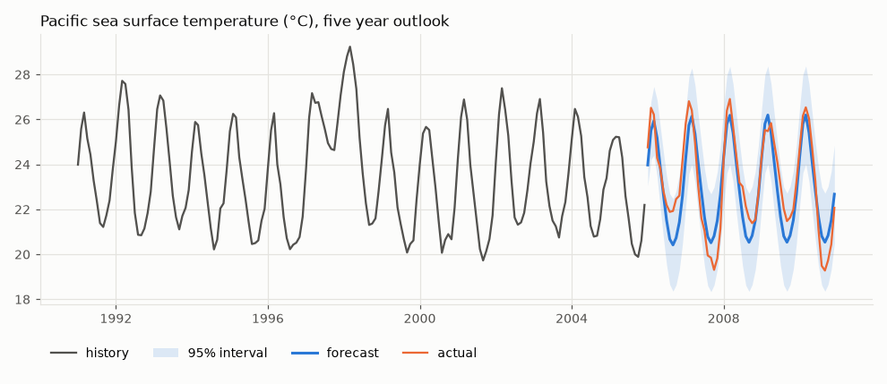
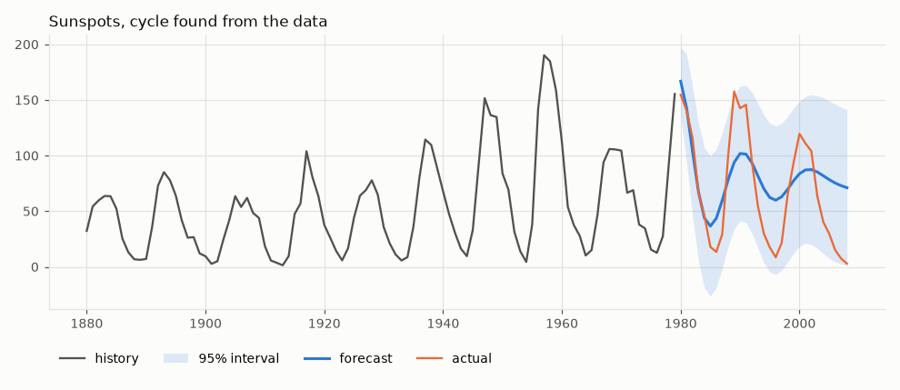
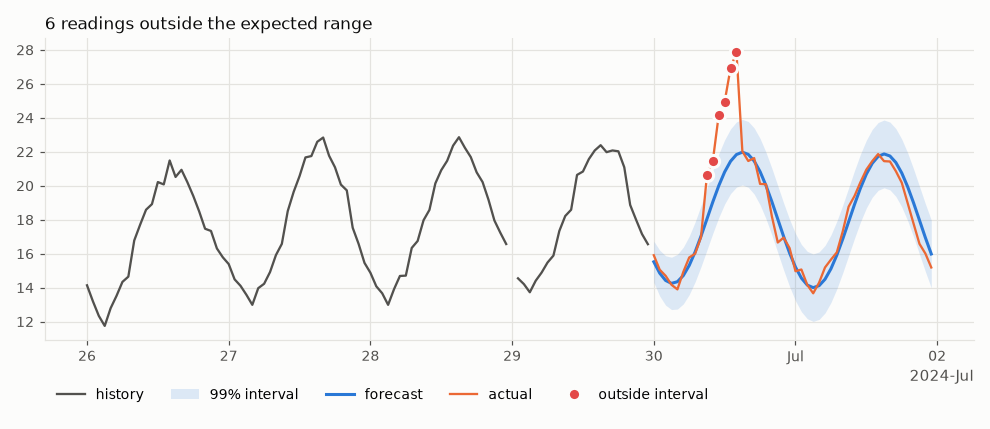
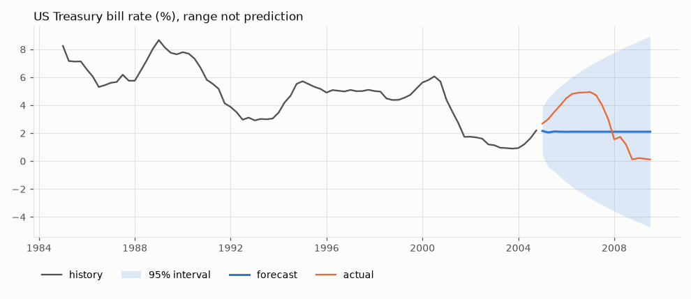
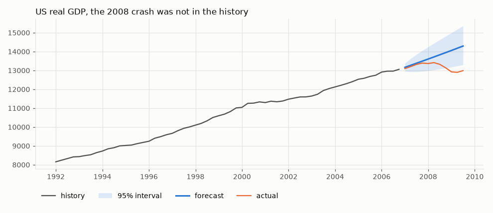

# Divinity

[](https://pypi.org/project/divinity-forecast/)
[](https://github.com/drds1/divinity/actions/workflows/tests.yml)
[](https://github.com/psf/black)

Automatic timeseries forecasting with prediction intervals you can trust.

Give it a series and a horizon. Divinity decides whether there is a trend, which seasonal cycles are real and how much autocorrelation is left over. It returns a forecast with an interval that widens as much as the data say it should, and no more.


## Install

```bash
pip install divinity-forecast
```

The package installs as `divinity-forecast` but is imported as `divinity`. Version 0.1 was published as `divinity` and is no longer maintained there.

Or from a clone, with the development tools

```bash
pip install -e ".[dev]"
```

Python 3.10 or later.

## Quick start

```python
import divinity as dv

model = dv.Forecaster().fit(y)      # y is a pandas Series, numpy array or list
result = model.predict(steps=30)    # DataFrame with forecast, lower, upper
print(model.summary())
model.plot(result)
```

```text
Divinity forecaster
  observations   1095
  frequency      D
  log scale      no
  trend          linear
  seasonality    365.25 (1 harmonic), 7 (3 harmonics)
  residuals      ARIMA(0, 0, 0)
```

Or in one line

```python
result = dv.forecast(y, steps=30)
```

`result` is indexed by future time. A Series with a `DatetimeIndex` gives future dates, anything else gives integer steps following on from the data.

```text
            forecast  lower  upper
2024-12-31     61.48  59.55  63.41
2025-01-01     61.55  59.62  63.49
...
```

The [demo notebook](https://github.com/drds1/divinity/blob/master/notebooks/demo.ipynb) walks through the API and the tricky cases, and the [applications notebook](https://github.com/drds1/divinity/blob/master/notebooks/applications.ipynb) works through real uses, from stock planning to anomaly detection.

## How it works

The series is modelled as a constant, plus an optional linear trend, plus Fourier terms for each seasonal period, plus ARIMA errors (regression with ARIMA errors).

1. **Candidate periods.** These come from the date frequency (7 and 365.25 for daily data, 12 for monthly, 24 and 168 for hourly and so on) and from peaks in the periodogram, so a cycle nobody mentioned can still be found. A period is only considered if the data cover at least two full cycles.
2. **Feature selection.** Trend and seasonal terms are added one at a time while they improve BIC. Extra harmonics of a period (for sharper, non-sinusoidal shapes) are only tried once the lower harmonic is in. There is an additional penalty for searching over many candidates. Without it, testing dozens of periods on noise will find one by chance.
3. **Random walk or not?** Before choosing any features, an augmented Dickey-Fuller test is run on what is left after removing the trend and the known periods. Detected periods are left out because they might be spurious. Testing first matters. On a random walk, spurious features soak up the wander and make the leftovers look stationary, so a test afterwards confirms its own mistake.
4. **Allowing for autocorrelation.** Least squares assumes independent errors, and on a random walk it declares almost any trend "significant". If the series has a unit root, features are selected on differenced data. Otherwise the autocorrelation of the residuals is estimated and features are reselected on quasi-differenced data (feasible GLS), repeating until the choice settles. The ARIMA order for what remains is chosen by BIC over a small grid. An order whose fit collapses onto the edge of the parameter space (an AR root on the unit circle cancelled by an MA root) is skipped in favour of the next best. For a differenced series a drift is kept at the AIC price rather than BIC, as R's `auto.arima` does, because a missed drift costs more the further ahead you forecast.
5. **Joint fit and intervals.** Features and ARIMA errors are fitted together by maximum likelihood. Forecast intervals combine the ARIMA forecast variance with the uncertainty in the trend and seasonal coefficients, which matters most when extrapolating a trend a long way. Student t quantiles allow for the noise level being estimated, which matters for short series.

The fitted model does not depend on the forecast horizon, so `predict(10)` is exactly the first ten rows of `predict(100)`.

## Can it be fooled?

The cases below are built to catch out a naive forecaster. Each was generated by [`divinity.synthetic`](https://github.com/drds1/divinity/blob/master/divinity/synthetic.py) with seed 0, the same seed the smoke tests use, so none of them were picked because they looked good. In every chart the orange line is the true future, which the model never saw.

### The standard case

A linear trend, a 20 step cycle and noise. Neither component is specified.


### Multiplicative seasonality

The seasonal swing grows with the level. Fitting with `log=True` handles this.


### Pure noise

There is nothing to find. A model that looks hard enough for structure will find some anyway. Divinity returns a flat forecast at the mean.


### A random walk

Random walks look trendy. Ordinary least squares picks a "significant" trend in the large majority of them, which is then extrapolated with false confidence. Divinity finds no trend or seasonality, switches to a differenced model and lets the interval fan out.


### Autocorrelated but stationary

The opposite trap. The series wanders but always returns to its mean. The forecast decays back towards the mean rather than treating it as a random walk.


### A period nobody mentioned

A cycle of 17.3 steps on integer data with no frequency. It is found from the periodogram, including the fractional part.


### Missing data

15% of values missing at random plus a 25 step gap. Gaps are handled natively, with no interpolation needed.


### Outliers

Three large one-off spikes.


### Very short history

Five weeks of daily data. The yearly default period cannot be estimated from that and is dropped automatically, while the weekly cycle is kept.


### Across 100 random seeds per case

One chart per case could still be luck, so [`benchmarks/run_benchmark.py`](https://github.com/drds1/divinity/blob/master/benchmarks/run_benchmark.py) refits every scenario on 100 different seeds. *Interval coverage* is how often the true future falls inside the 95% interval, so it should be close to 95%. *Structure found* is how often the model chose the components the series was built with (for example no seasonality on noise, differencing on a random walk, period 17.3 when it is hidden). *RMSE vs naive* compares the error with simply repeating the last observed value, where below 1 is better.

| scenario | runs | 95% interval coverage | structure found | RMSE vs naive |
|---|---:|---:|---:|---:|
| `trend_seasonal` | 100 | 94.3% | 100% | 0.24 |
| `daily_multi_seasonal` | 100 | 95.1% | 100% | 0.32 |
| `monthly_multiplicative` | 100 | 94.0% | 100% | 0.19 |
| `white_noise` | 100 | 94.8% | 98% | 0.75 |
| `random_walk` | 100 | 93.8% | 94% | 1.06 |
| `ar1` | 100 | 91.9% | 88% | 0.83 |
| `missing_data` | 100 | 93.9% | 100% | 0.23 |
| `unknown_period` | 100 | 95.2% | 100% | 0.27 |
| `outliers` | 100 | 100.0% | 100% | 0.43 |
| `short_daily` | 100 | 92.4% | 100% | 0.38 |

How to read the weaker rows

- **`ar1` (91.9%).** Autoregressive coefficients estimated from 200 points are biased slightly towards zero, so the intervals come out a little narrow. In 12% of runs the model reads the series as a random walk or adds a small trend. Both are hard to tell apart from a strongly autocorrelated series of this length.
- **`random_walk` (RMSE 1.06).** For a random walk the naive forecast is the best possible point forecast, so about 1.0 is the floor. The small excess is the price of keeping a drift when one is supported, which is what makes trending series like CO₂ forecast well. What matters here is the interval, and 94% coverage means the fan is honest.
- **`short_daily` (92.4%).** 35 points carrying seven seasonal coefficients leaves little to estimate the noise from, even with t quantiles.
- **`outliers` (100%).** The spikes inflate the estimated noise, so the intervals are wider than they need to be. This errs in the safe direction.

Regenerate it with

```bash
python benchmarks/run_benchmark.py --seeds 100
```

## Practical applications

Anything measured regularly over time, where the next value matters and so does how sure you can be of it. Each example below is a few lines of code, and every chart in this section is produced by running exactly that code. The [applications notebook](https://github.com/drds1/divinity/blob/master/notebooks/applications.ipynb) goes further with each one.

Real data comes bundled with statsmodels, so nothing needs downloading. Business data is simulated (and labelled as such), because real company figures are not public.

| Application | What the forecast gives you | Data |
|---|---|---|
| [Retail demand planning](#retail-demand-planning) | how much stock to order so you rarely run out | simulated daily sales |
| [Capacity planning](#capacity-planning) | how many servers or staff to have on at peak | simulated hourly web traffic |
| [Revenue budgeting](#revenue-budgeting) | next year's monthly budget with a realistic range | simulated monthly revenue |
| [Environmental monitoring](#environmental-monitoring) | where a measurement is heading, despite gaps | real Mauna Loa CO₂, weekly |
| [Seasonal climate outlook](#seasonal-climate-outlook) | the expected seasonal pattern and its spread | real Pacific sea temperature, monthly |
| [Discovering cycles](#discovering-cycles) | which cycles are real, found from the data | real sunspot counts, yearly |
| [Anomaly detection](#anomaly-detection) | readings that the past says should not happen | simulated hourly sensor with a fault |
| [Financial risk ranges](#financial-risk-ranges) | a plausible range when the value itself is unpredictable | real US Treasury bill rate, quarterly |
| [Knowing the limits](#knowing-the-limits) | what no forecast from history alone can see | real US GDP, quarterly |

Other uses with the same shape include call centre staffing, energy demand, hospital admissions, footfall and app sign-ups.

### Retail demand planning

Order enough stock to meet demand on most days without over-ordering. The upper end of a 90% interval is the 95th percentile, so ordering that much covers demand on about 19 days in 20.

<!-- example: retail -->
```python
import divinity as dv
from divinity import datasets

sales = datasets.retail_sales()  # simulated daily units sold
history, actual = sales[:-90], sales[-90:]

model = dv.Forecaster().fit(history)
plan = model.predict(90, interval=0.9)
plan["order_quantity"] = plan["upper"].round()

model.plot(plan, actual=actual, history=180, title="Retail demand, next 90 days")
```



The model picks up the busy weekends, the summer lull and the run up to Christmas without being told about any of them.

### Capacity planning

Provision servers (or staff) for the busiest hour you can realistically expect. With `interval=0.98` the upper bound is the 99th percentile for each hour.

<!-- example: capacity -->
```python
import divinity as dv
from divinity import datasets

visits = datasets.web_traffic()  # simulated hourly visits
history, actual = visits[: -7 * 24], visits[-7 * 24 :]

model = dv.Forecaster().fit(history)
week = model.predict(7 * 24, interval=0.98)
peak = week["upper"].max()  # provision for this many visits an hour

model.plot(week, actual=actual, history=14 * 24, title=f"Next week, provision for {peak:,.0f} visits an hour")
```



Daily and weekly cycles come from the hourly frequency automatically.

### Revenue budgeting

A growing business has seasonal swings that grow with it, so fit on the log scale.

<!-- example: budget -->
```python
import divinity as dv
from divinity import datasets

revenue = datasets.monthly_revenue()  # simulated, thousands of pounds
history, actual = revenue[:-24], revenue[-24:]

model = dv.Forecaster(log=True).fit(history)
budget = model.predict(24)

model.plot(budget, actual=actual, history=72, title="Monthly revenue (£k), two year budget")
```



The interval is asymmetric because it is symmetric on the log scale. Upside is larger than downside, as it is for real growth.

### Environmental monitoring

Weekly CO₂ readings from Mauna Loa, with weeks missing where the instruments were down. The gaps need no special handling.

<!-- example: co2 -->
```python
import divinity as dv
from divinity import datasets

co2 = datasets.co2()  # real weekly data, with missing weeks
model = dv.Forecaster().fit(co2["1988":"1999"])
outlook = model.predict(104)  # two years ahead

model.plot(outlook, actual=co2["2000":], history=260, title="Atmospheric CO₂ (ppm) at Mauna Loa")
```



The yearly cycle is found from the weekly frequency, and the upward drift carries on through the forecast.

### Seasonal climate outlook

Monthly sea surface temperature in the El Niño region of the Pacific. The seasonal shape is predictable. El Niño and La Niña years are not, and the interval reflects that.

<!-- example: climate -->
```python
import divinity as dv
from divinity import datasets

sst = datasets.elnino()  # real monthly sea surface temperature
model = dv.Forecaster().fit(sst[:"2005"])
outlook = model.predict(60)

model.plot(outlook, actual=sst["2006":], history=180, title="Pacific sea surface temperature (°C), five year outlook")
```



### Discovering cycles

Yearly sunspot counts since 1700. Nobody tells the model about the solar cycle.

<!-- example: sunspots -->
```python
import divinity as dv
from divinity import datasets

sun = datasets.sunspots()  # real yearly counts
model = dv.Forecaster().fit(sun[:"1979"])
print(model.summary())

model.plot(model.predict(29), actual=sun["1980":], history=100, title="Sunspots, cycle found from the data")
```



The summary reports cycles of about 11 and 10 years, the well known solar cycle and its variation in length. The cycle is not perfectly regular, so the forecast drifts out of phase over several cycles, and the interval widens to allow for it. The lower bound dips below zero because the model does not know counts cannot be negative. Clip it at zero, or use `log=True` on a strictly positive series.

### Anomaly detection

Forecast what a sensor should read, then flag readings outside a 99% interval. Here a simulated temperature sensor develops a fault on its last day.

<!-- example: anomaly -->
```python
import divinity as dv
from divinity import datasets

readings = datasets.sensor_readings()  # simulated hourly readings, fault on the last day
history, recent = readings[:-48], readings[-48:]

model = dv.Forecaster(interval=0.99).fit(history)
expected = model.predict(48)
alarms = recent[(recent < expected["lower"]) | (recent > expected["upper"])]

model.plot(expected, actual=recent, highlight=alarms, history=96, title=f"{len(alarms)} readings outside the expected range")
```



All six faulty readings are flagged and nothing else is. A fixed threshold would either miss the fault (it starts small, in the warm part of the day) or fire every afternoon.

### Financial risk ranges

Interest rates and prices behave much like random walks, so no method can say where they will go. What a forecast can give is an honest range.

<!-- example: rates -->
```python
import divinity as dv
from divinity import datasets

rate = datasets.us_macro("tbilrate")  # real 3 month Treasury bill rate (%)
model = dv.Forecaster().fit(rate[:"2004"])

model.plot(model.predict(19), actual=rate["2005":], history=80, title="US Treasury bill rate (%), range not prediction")
```



The model finds no structure, says so with a flat forecast, and lets the range fan out. The 2008 cut to near zero falls inside it. The lower end goes well below zero, which a model that knows nothing about interest rates cannot rule out, so treat it as "towards zero".

### Knowing the limits

Any forecast built from a series' own history assumes the future behaves like the past. US GDP fitted up to 2006 shows what happens when it does not.

<!-- example: limits -->
```python
import divinity as dv
from divinity import datasets

gdp = datasets.us_macro("realgdp")  # real GDP, billions of 2005 dollars
model = dv.Forecaster(log=True).fit(gdp[:"2006"])

model.plot(model.predict(11), actual=gdp["2007":], history=60, title="US real GDP, the 2008 crash was not in the history")
```



The forecast is a sensible continuation of the trend and the 2008 recession falls outside it. Use forecasts for planning under normal conditions and keep the limitations below in mind.

## Options

```python
dv.Forecaster(
    seasonal_periods="auto",  # "auto" (from the frequency), a list of periods, or None
    detect_periods=True,      # also look for periods in the data
    max_detected_periods=3,
    max_harmonics=3,          # Fourier harmonics per period, more allow sharper shapes
    trend="auto",             # "auto", "linear" or None
    arima="auto",             # "auto", a (p, d, q) tuple, or None for white noise
    log=False,                # fit on the log scale, for growth with growing seasonality
    interval=0.95,            # default interval coverage
    search_penalty=1.0,       # higher is more reluctant to add seasonality, 0 is plain BIC
)
```

Useful things on a fitted model

| | |
|---|---|
| `predict(steps, interval=None)` | forecast DataFrame (`forecast`, `lower`, `upper`) |
| `plot(forecast, actual=None, history=None)` | chart, returns the matplotlib Axes |
| `summary()` | readable description of what was chosen |
| `components_` | the same as a dict |
| `fitted_` | in-sample one step ahead predictions |

If dates are missing entirely from a `DatetimeIndex` the frequency cannot be inferred. Pass it, for example `fit(y, freq="D")`, and the gaps become missing values.

## Limitations

- Trends are linear. A curve or saturation will be extrapolated as a straight line.
- Level shifts and regime changes are not modelled.
- Outliers are not removed. They widen the interval a little instead.
- Seasonal shape is fixed (or proportional to the level with `log=True`).
- One series at a time, with no external regressors.

## Development

```bash
pip install -e ".[dev]"
pre-commit install
pytest -m "not slow"      # fast unit and smoke tests
pytest                    # also the coverage checks over many seeds (a few minutes)
python benchmarks/run_benchmark.py --seeds 100   # the coverage table above
python docs/make_figures.py                      # the charts above
jupyter execute --inplace notebooks/*.ipynb     # rerun both notebooks
```

To try the scenarios yourself, `divinity.synthetic.make(name, seed)` returns a training history, the true future and any options the scenario needs. The names are in `divinity.synthetic.SCENARIOS`.

The code is in [`divinity/`](https://github.com/drds1/divinity/tree/master/divinity/), with one module per stage: `periods.py` (candidate periods), `features.py` (trend and Fourier terms), `selection.py` (feature selection), `residuals.py` (ARIMA order) and `forecaster.py` (the `Forecaster` class tying them together). `synthetic.py` holds the test scenarios and `datasets.py` the example data used under Practical applications.

### Upgrading from 0.1

Version 0.1 was installed as `divinity`, which uses the same import name. Remove it before installing the new package, or the two will overwrite each other's files.

```bash
pip uninstall divinity
pip install divinity-forecast
```

The old `divinity.divinity(forecast_length=...)` class still works but is deprecated and now runs the new model underneath. Replace

```python
model = dv.divinity(forecast_length=20)
model.fit(y)
y_pred = model.predict()
```

with

```python
result = dv.Forecaster().fit(y).predict(20)
y_pred = result["forecast"]
```
