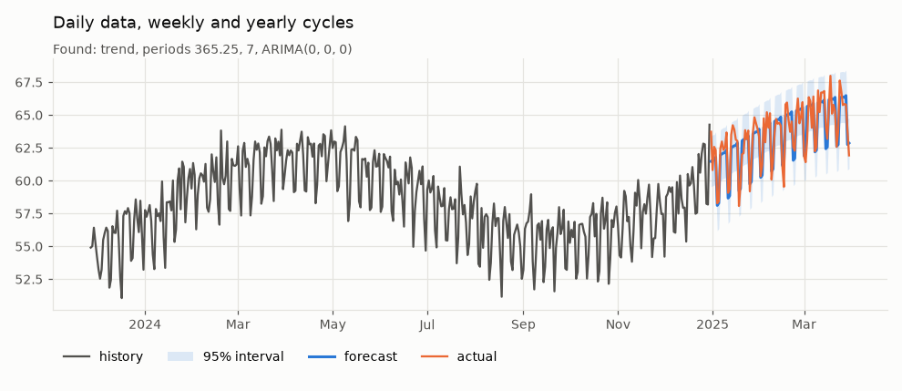
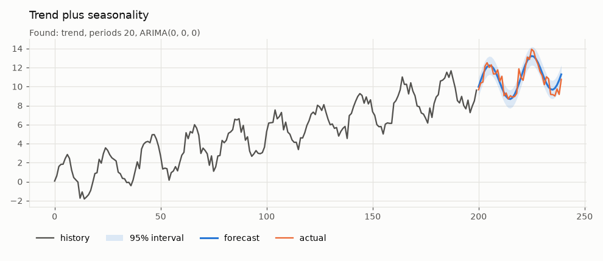
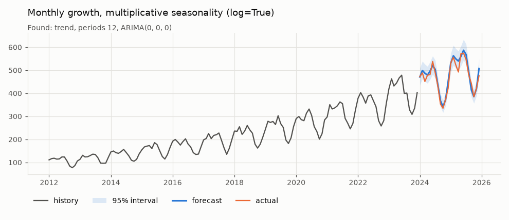
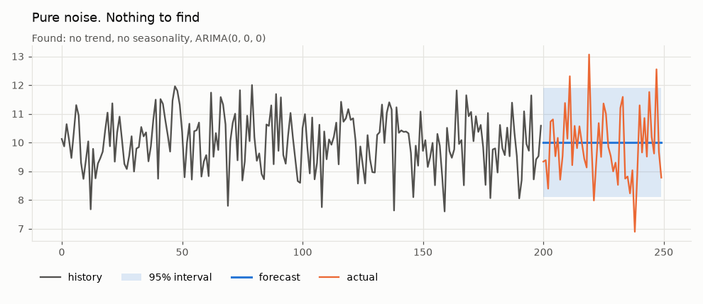
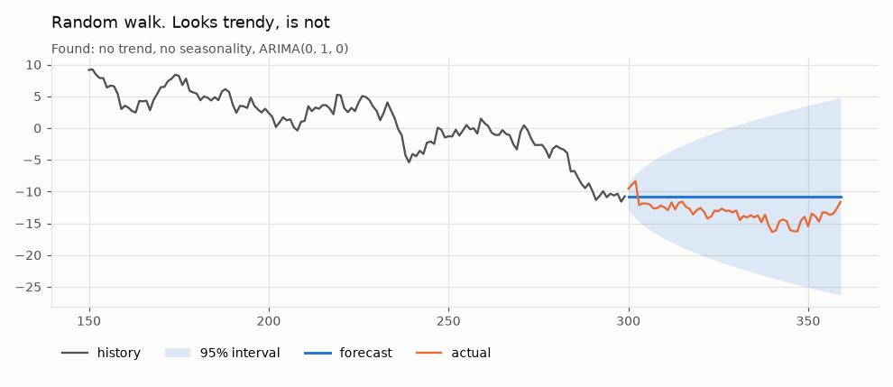
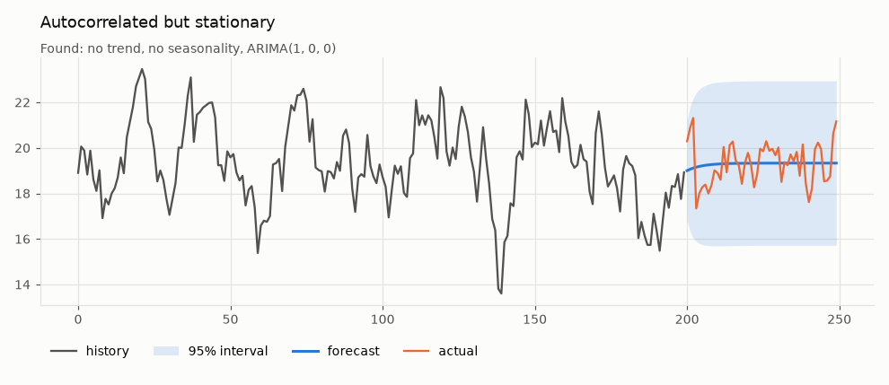
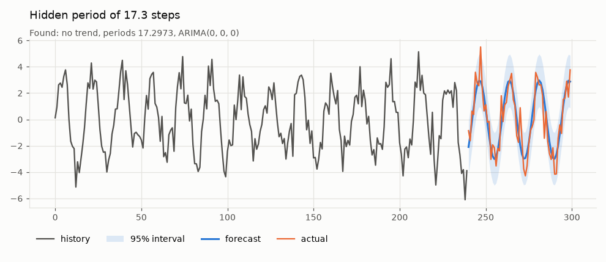
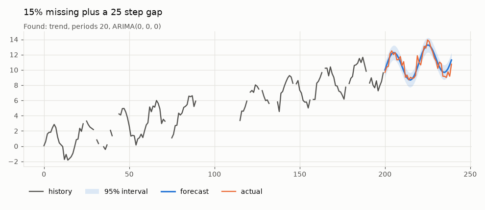
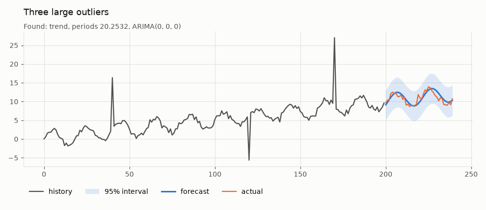
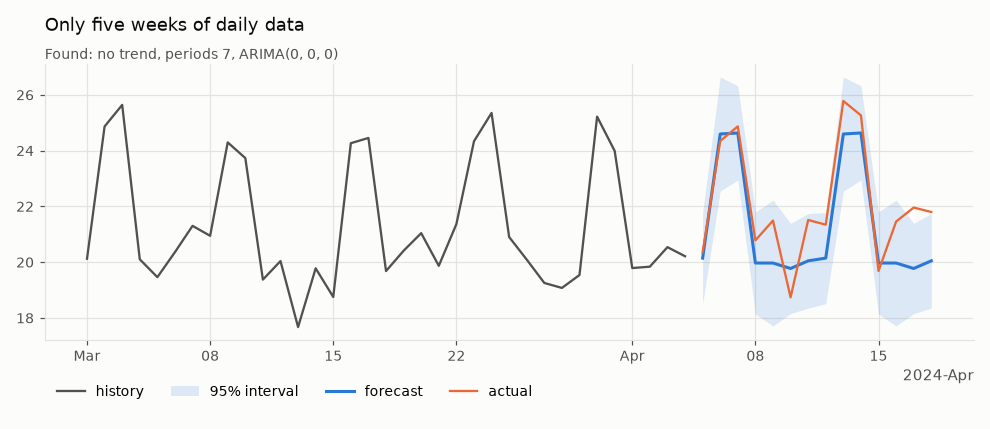

# Divinity

[](https://github.com/psf/black)

Automatic timeseries forecasting with prediction intervals you can trust.

Give it a series and a horizon. Divinity decides whether there is a trend, which seasonal cycles are real and how much autocorrelation is left over. It returns a forecast with an interval that widens as much as the data say it should, and no more.



## Install

```bash
pip install divinity
```

Or from a clone, with the development tools

```bash
pip install -e ".[dev]"
```

Python 3.10 or later.

## Quick start

```python
import divinity as dv

model = dv.Forecaster().fit(y)      # y is a pandas Series, numpy array or list
result = model.predict(steps=30)    # DataFrame with forecast, lower, upper
print(model.summary())
model.plot(result)
```

```text
Divinity forecaster
  observations   1095
  frequency      D
  log scale      no
  trend          linear
  seasonality    365.25 (1 harmonic), 7 (3 harmonics)
  residuals      ARIMA(0, 0, 0)
```

Or in one line

```python
result = dv.forecast(y, steps=30)
```

`result` is indexed by future time. A Series with a `DatetimeIndex` gives future dates, anything else gives integer steps following on from the data.

```text
            forecast  lower  upper
2024-12-31     61.48  59.55  63.41
2025-01-01     61.55  59.62  63.49
...
```

The [demo notebook](https://github.com/drds1/divinity/blob/master/notebooks/demo.ipynb) walks through everything below with live examples.

## How it works

The series is modelled as a constant, plus an optional linear trend, plus Fourier terms for each seasonal period, plus ARIMA errors (regression with ARIMA errors).

1. **Candidate periods.** These come from the date frequency (7 and 365.25 for daily data, 12 for monthly, 24 and 168 for hourly and so on) and from peaks in the periodogram, so a cycle nobody mentioned can still be found. A period is only considered if the data cover at least two full cycles.
2. **Feature selection.** Trend and seasonal terms are added one at a time while they improve BIC. Extra harmonics of a period (for sharper, non-sinusoidal shapes) are only tried once the lower harmonic is in. There is an additional penalty for searching over many candidates. Without it, testing dozens of periods on noise will find one by chance.
3. **Random walk or not?** Before choosing any features, an augmented Dickey-Fuller test is run on what is left after removing the trend and the known periods. Detected periods are left out because they might be spurious. Testing first matters. On a random walk, spurious features soak up the wander and make the leftovers look stationary, so a test afterwards confirms its own mistake.
4. **Allowing for autocorrelation.** Least squares assumes independent errors, and on a random walk it declares almost any trend "significant". If the series has a unit root, features are selected on differenced data. Otherwise the autocorrelation of the residuals is estimated and features are reselected on quasi-differenced data (feasible GLS), repeating until the choice settles. The ARIMA order for what remains is chosen by BIC over a small grid.
5. **Joint fit and intervals.** Features and ARIMA errors are fitted together by maximum likelihood. Forecast intervals combine the ARIMA forecast variance with the uncertainty in the trend and seasonal coefficients, which matters most when extrapolating a trend a long way. Student t quantiles allow for the noise level being estimated, which matters for short series.

The fitted model does not depend on the forecast horizon, so `predict(10)` is exactly the first ten rows of `predict(100)`.

## Can it be fooled?

The cases below are built to catch out a naive forecaster. Each was generated by [`divinity.synthetic`](https://github.com/drds1/divinity/blob/master/divinity/synthetic.py) with seed 0, the same seed the smoke tests use, so none of them were picked because they looked good. In every chart the orange line is the true future, which the model never saw.

### The standard case

A linear trend, a 20 step cycle and noise. Neither component is specified.



### Multiplicative seasonality

The seasonal swing grows with the level. Fitting with `log=True` handles this.



### Pure noise

There is nothing to find. A model that looks hard enough for structure will find some anyway. Divinity returns a flat forecast at the mean.



### A random walk

Random walks look trendy. Ordinary least squares picks a "significant" trend in the large majority of them, which is then extrapolated with false confidence. Divinity finds no trend or seasonality, switches to a differenced model and lets the interval fan out.



### Autocorrelated but stationary

The opposite trap. The series wanders but always returns to its mean. The forecast decays back towards the mean rather than treating it as a random walk.



### A period nobody mentioned

A cycle of 17.3 steps on integer data with no frequency. It is found from the periodogram, including the fractional part.



### Missing data

15% of values missing at random plus a 25 step gap. Gaps are handled natively, with no interpolation needed.



### Outliers

Three large one-off spikes.



### Very short history

Five weeks of daily data. The yearly default period cannot be estimated from that and is dropped automatically, while the weekly cycle is kept.



### Across 100 random seeds per case

One chart per case could still be luck, so [`benchmarks/coverage.py`](https://github.com/drds1/divinity/blob/master/benchmarks/coverage.py) refits every scenario on 100 different seeds. *Interval coverage* is how often the true future falls inside the 95% interval, so it should be close to 95%. *Structure found* is how often the model chose the components the series was built with (for example no seasonality on noise, differencing on a random walk, period 17.3 when it is hidden). *RMSE vs naive* compares the error with simply repeating the last observed value, where below 1 is better.

| scenario | runs | 95% interval coverage | structure found | RMSE vs naive |
|---|---:|---:|---:|---:|
| `trend_seasonal` | 100 | 94.3% | 100% | 0.24 |
| `daily_multi_seasonal` | 100 | 95.1% | 100% | 0.32 |
| `monthly_multiplicative` | 100 | 93.9% | 97% | 0.20 |
| `white_noise` | 100 | 94.8% | 98% | 0.75 |
| `random_walk` | 100 | 93.9% | 94% | 1.04 |
| `ar1` | 100 | 91.8% | 88% | 0.82 |
| `missing_data` | 100 | 93.9% | 100% | 0.23 |
| `unknown_period` | 100 | 95.0% | 100% | 0.27 |
| `outliers` | 100 | 100.0% | 100% | 0.43 |
| `short_daily` | 100 | 91.4% | 100% | 0.38 |

How to read the weaker rows

- **`ar1` (91.8%).** Autoregressive coefficients estimated from 200 points are biased slightly towards zero, so the intervals come out a little narrow. In 12% of runs the model reads the series as a random walk or adds a small trend. Both are hard to tell apart from a strongly autocorrelated series of this length.
- **`random_walk` (RMSE 1.04).** For a random walk the naive forecast is the best possible point forecast, so about 1.0 is the floor. What matters here is the interval, and 94% coverage means the fan is honest.
- **`short_daily` (91.4%).** 35 points carrying seven seasonal coefficients leaves little to estimate the noise from, even with t quantiles.
- **`outliers` (100%).** The spikes inflate the estimated noise, so the intervals are wider than they need to be. This errs in the safe direction.

Regenerate it with

```bash
python benchmarks/coverage.py --seeds 100
```

## Options

```python
dv.Forecaster(
    seasonal_periods="auto",  # "auto" (from the frequency), a list of periods, or None
    detect_periods=True,      # also look for periods in the data
    max_detected_periods=3,
    max_harmonics=3,          # Fourier harmonics per period, more allow sharper shapes
    trend="auto",             # "auto", "linear" or None
    arima="auto",             # "auto", a (p, d, q) tuple, or None for white noise
    log=False,                # fit on the log scale, for growth with growing seasonality
    interval=0.95,            # default interval coverage
    search_penalty=1.0,       # higher is more reluctant to add seasonality, 0 is plain BIC
)
```

Useful things on a fitted model

| | |
|---|---|
| `predict(steps, interval=None)` | forecast DataFrame (`forecast`, `lower`, `upper`) |
| `plot(forecast, actual=None, history=None)` | chart, returns the matplotlib Axes |
| `summary()` | readable description of what was chosen |
| `components_` | the same as a dict |
| `fitted_` | in-sample one step ahead predictions |

If dates are missing entirely from a `DatetimeIndex` the frequency cannot be inferred. Pass it, for example `fit(y, freq="D")`, and the gaps become missing values.

## Limitations

- Trends are linear. A curve or saturation will be extrapolated as a straight line.
- Level shifts and regime changes are not modelled.
- Outliers are not removed. They widen the interval a little instead.
- Seasonal shape is fixed (or proportional to the level with `log=True`).
- One series at a time, with no external regressors.

## Development

```bash
pip install -e ".[dev]"
pre-commit install
pytest -m "not slow"      # fast unit and smoke tests
pytest                    # also the coverage checks over many seeds (a few minutes)
python docs/make_figures.py
```

The code is in [`divinity/`](https://github.com/drds1/divinity/tree/master/divinity/), with one module per stage: `periods.py` (candidate periods), `features.py` (trend and Fourier terms), `selection.py` (feature selection), `residuals.py` (ARIMA order) and `forecaster.py` (the `Forecaster` class tying them together). `synthetic.py` holds the test scenarios.

### Upgrading from 0.1

The old `divinity.divinity(forecast_length=...)` class still works but is deprecated and now runs the new model underneath. Replace

```python
model = dv.divinity(forecast_length=20)
model.fit(y)
y_pred = model.predict()
```

with

```python
result = dv.Forecaster().fit(y).predict(20)
y_pred = result["forecast"]
```
